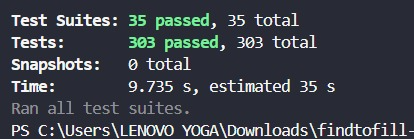

# FindToFill Test Report

FindToFill passed 275 of 275 automated tests (Jest) in about 17 seconds. Tests are grouped per build for integration testing, then run across the whole application (system testing) and repeated to confirm that existing capabilities still work (regression testing). Manual testing in the browser has not been run yet.

## 1. Automated Test Results

### Metrics summary

| Metric | Result |
|---|---|
| Test runner | Jest 30.5.2, with React Testing Library and jsdom |
| Test files | 30 |
| Tests passed | 275 |
| Tests failed / skipped | 0 / 0 |
| Builds passed | 6 of 6 |
| Regression (Builds 1 to 5 after Build 6) | 226 of 226 passed |
| Lint and type check | 0 errors |
| Status | 100% passed |

### Scope and environment

| | |
|---|---|
| **Application** | FindToFill: finder for water refill dispensers and charging stations inside KRL stations (Jabodetabek) |
| **Tools** | Jest 30.5.2, React Testing Library, jsdom, ESLint 9, TypeScript strict (Node 22+) |
| **Test data** | Fake in-memory Supabase, mocked Groq and Gemini clients. No internet needed and the real database is never touched. |
| **Reference** | Test cases TC-01 to TC-17 and the build (sprint) breakdown in `docs/BUILD_PLAN.md` |

### Summary per build

| Build | Focus | Test cases | Tests | Passed | Cumulative | Status |
|---|---|---|---:|---:|---:|---|
| Build 1 (Sprint 1) | Database and Auth | TC-01, TC-02 | 42 | 42 | 42/42 | PASSED |
| Build 2 (Sprint 2) | Locator | TC-03, TC-04 | 43 | 43 | 85/85 | PASSED |
| Build 3 (Sprint 3) | Live report | TC-05, TC-06, TC-07, TC-17 | 56 | 56 | 141/141 | PASSED |
| Build 4 (Sprint 4) | Reviews, favorites, stamps | TC-08, TC-09 | 54 | 54 | 195/195 | PASSED |
| Build 5 (Sprint 5, partial) | Chatbot helpers | TC-10 to TC-14 | 31 | 31 | 226/226 | PASSED |
| Build 6 (Sprint 6) | Admin and moderation | TC-15, TC-16 | 49 | 49 | 275/275 | PASSED |

## 2. Testing Approach

> **Integration process** is executed in carefully planned builds. In this project one build equals one sprint in `docs/BUILD_PLAN.md` (Build 1 to 6), and each build is merged into the previous ones step by step.

| Test type | Scope | How it is done in FindToFill |
|---|---|---|
| **Integration testing** | Each build | The tests of each build are run on their own, then cumulatively together with the earlier builds. Integration tests exercise route handlers, services, data helpers, and the fake Supabase together (for example `reportsRoute`, `stationRoutes`, `adminManageRoutes`). |
| **System testing** | Whole application | The entire suite is run at once with coverage, plus lint and type check. Browser scenarios against the real database are recorded as a manual checklist. |
| **Regression testing** | Verify that changes do not compromise pre-existing capabilities | The tests of Builds 1 to 5 are re-run after the admin code (Build 6) was added, then the whole suite is run again. |

## 3. Integration Testing (per build)

Each build is tested on its own and cumulatively with the previous builds, so an integration problem shows up in the build that caused it. The scope of each build follows the sprint breakdown in `docs/BUILD_PLAN.md` and the git history.

### 3.1 Build 1 (Sprint 1): Database and Auth (TC-01, TC-02)

| Integrated module | Test file | Tests | Passed | Status |
|---|---|---:|---:|---|
| API error format | `apiErrors.test.ts` | 9 | 9 | PASSED |
| Database schema and RLS | `migrations.test.ts` | 19 | 19 | PASSED |
| Login, commuter/admin roles | `roles.test.ts` | 4 | 4 | PASSED |
| Seed data validation (CSV) | `seed.test.ts` | 10 | 10 | PASSED |
| **Build total** | | **42** | **42** | **PASSED** |

Cumulative check after merging this build with the previous ones: **42/42 tests passed**.

### 3.2 Build 2 (Sprint 2): Locator (TC-03, TC-04)

| Integrated module | Test file | Tests | Passed | Status |
|---|---|---:|---:|---|
| Status badge (color, text, icon) | `StatusBadge.test.tsx` | 5 | 5 | PASSED |
| Haversine distance and walking time | `geo.test.ts` | 8 | 8 | PASSED |
| Nearest facilities and filters | `locator.test.ts` | 10 | 10 | PASSED |
| Database-to-app mappers | `mappers.test.ts` | 5 | 5 | PASSED |
| Station and facility API | `stationRoutes.test.ts` | 11 | 11 | PASSED |
| Station service (browser) | `stationService.test.ts` | 4 | 4 | PASSED |
| **Build total** | | **43** | **43** | **PASSED** |

Cumulative check after merging this build with the previous ones: **85/85 tests passed**.

### 3.3 Build 3 (Sprint 3): Live report (TC-05, TC-06, TC-07, TC-17)

| Integrated module | Test file | Tests | Passed | Status |
|---|---|---:|---:|---|
| Rate limit, 5 reports per hour | `rateLimit.test.ts` | 4 | 4 | PASSED |
| Photo and note validation | `reportInput.test.ts` | 16 | 16 | PASSED |
| Report service (browser) | `reportService.test.ts` | 3 | 3 | PASSED |
| Report API: photo required, max 5 MB | `reportsRoute.test.ts` | 11 | 11 | PASSED |
| 7-day status rule | `status.test.ts` | 14 | 14 | PASSED |
| Submit report and first stamp | `submitReport.test.ts` | 8 | 8 | PASSED |
| **Build total** | | **56** | **56** | **PASSED** |

Cumulative check after merging this build with the previous ones: **141/141 tests passed**.

### 3.4 Build 4 (Sprint 4): Reviews, favorites, stamps (TC-08, TC-09)

| Integrated module | Test file | Tests | Passed | Status |
|---|---|---:|---:|---|
| Review form | `ReviewSheet.test.tsx` | 5 | 5 | PASSED |
| Community service (browser) | `communityClient.test.ts` | 8 | 8 | PASSED |
| Gemini embeddings (768 dimensions) | `embeddings.test.ts` | 8 | 8 | PASSED |
| Favorites and stamps | `favoritesStamps.test.ts` | 8 | 8 | PASSED |
| Review API and validation | `reviewsRoute.test.ts` | 14 | 14 | PASSED |
| Reviews: create, edit, embedding | `submitReview.test.ts` | 11 | 11 | PASSED |
| **Build total** | | **54** | **54** | **PASSED** |

Cumulative check after merging this build with the previous ones: **195/195 tests passed**.

### 3.5 Build 5 (Sprint 5, partial): Chatbot helpers (TC-10 to TC-14)

| Integrated module | Test file | Tests | Passed | Status |
|---|---|---:|---:|---|
| Chat rate limit and logs | `chatSupport.test.ts` | 9 | 9 | PASSED |
| Groq client | `groqClient.test.ts` | 3 | 3 | PASSED |
| Review search for the chatbot | `reviewSearch.test.ts` | 5 | 5 | PASSED |
| Next train schedule (WIB) | `schedules.test.ts` | 14 | 14 | PASSED |
| **Build total** | | **31** | **31** | **PASSED** |

Cumulative check after merging this build with the previous ones: **226/226 tests passed**.

### 3.6 Build 6 (Sprint 6): Admin and moderation (TC-15, TC-16)

| Integrated module | Test file | Tests | Passed | Status |
|---|---|---:|---:|---|
| Admin page: filters and Remove | `adminClient.test.tsx` | 10 | 10 | PASSED |
| Admin API: moderation and data management | `adminManageRoutes.test.ts` | 25 | 25 | PASSED |
| Admin-only station/facility editing | `adminRoutes.test.ts` | 6 | 6 | PASSED |
| Remove (soft delete) for reports and reviews | `moderation.test.ts` | 8 | 8 | PASSED |
| **Build total** | | **49** | **49** | **PASSED** |

Cumulative check after merging this build with the previous ones: **275/275 tests passed**.

## 4. System Testing (whole application)

### 4.1 Full automated suite

All 30 test files were run at once: **275/275 tests passed**. Coverage: statements 89.1%, branches 83.9%, functions 82.8%, lines 89.1%. These figures only count files imported by tests, so they are not the coverage of the whole application.

Screenshot of the `npm test` result run by the team on another computer:

*Figure 4.1. `npm test` result: 35 suites and 303 tests passed (9.7 seconds).*

> Note: the numbers in this screenshot (35 suites, 303 tests) are higher than the run made for this document (30 suites, 275 tests), probably because a different version of the code was tested (for example extra tests from another branch). The figures in the tables above come from this repo at the time of testing.

### 4.2 Static checks

`npm run lint` and `npm run typecheck` were run on the whole codebase and both finished with no errors or warnings (exit code 0).

### 4.3 End-to-end scenarios in the browser (manual)

These scenarios need a running server and the real Supabase, so they have **not been run** in this round of testing. The "Automated basis" column shows the parts already guarded by automated tests.

| Scenario | Automated basis | Manual status |
|---|---|---|
| Register, log in, and continue as guest | roles, apiErrors | Not run |
| Open Home, detect station, see nearest facilities with distance in meters | geo, locator, stationRoutes | Not run |
| Submit a report with a photo, status changes, first stamp | submitReport, reportsRoute, status | Not run |
| 6th report within one hour is rejected | rateLimit | Not run |
| Write a review, favorite, view Community and Station Layout | submitReview, favoritesStamps, ReviewSheet | Not run |
| Admin removes a report or review, commuter is rejected | moderation, adminManageRoutes, roles | Not run |
| Chatbot quick message using the 5 tools | schedules, reviewSearch, chatSupport, groqClient (helpers only) | Waiting for the orchestrator (Sprint 5) |

## 5. Regression Testing

After the admin and moderation code (Build 6) was added, the tests of Builds 1 to 5 were re-run without changing them, to confirm that existing capabilities are not broken. Result: **226/226 tests passed**. The whole suite was then run again (see 4.1): **275/275 tests passed**.

Build 6 also touched older files (`reportService.ts`, `reviewService.ts`, `validation.ts`, `schedules.ts`, `config.ts`, `types/index.ts`). The existing tests for those files also passed, so no pre-existing capability is broken according to the tests we have.

## 6. How to Re-run

| Goal | Command |
|---|---|
| Whole suite (system and regression) | `npm test` |
| One build | `npx jest tests/geo.test.ts tests/locator.test.ts ...` |
| Name of every scenario | `npx jest --verbose` |
| Coverage | `npx jest --coverage` |
| Lint and types | `npm run lint` and `npm run typecheck` |

## 7. Limitations

- The chatbot orchestrator (Groq and the 5 tools) is still in development, so Build 5 only contains the helpers and the 20-case evaluation (TC-10 to TC-14) does not exist yet.
- End-to-end browser scenarios (4.3), Lighthouse, and the Vercel deploy have not been run.
- RLS is not run on a real PostgreSQL. Migrations are checked through static tests on the SQL files and still need manual verification in Supabase.
- The assignment of tests to builds uses the sprint mapping in `docs/BUILD_PLAN.md` and the commit history. Build 6 was not committed yet when this testing was run.
- Regression was done by re-running the existing tests, not by comparing against stored earlier results.
